# Design changes

The accessibility work changed some colours, and the [polish pass](#polish-pass) changed some components. This page keeps a **visual record of the design before and after**, so you can compare them and go back if needed.

- **Before** = the original design (commit `0569724`, before any colour changes)
- **After** = the current design

Screenshots: `design-changes/before` and `design-changes/after`. To recapture them after a future change:

```bash
pnpm --filter @acme/ui build-storybook
node scripts/design-screenshots.mjs packages/ui/storybook-static packages/ui/design-changes/after
```

## How to go back

The token values live in `packages/tokens/tokens.json`, and `tokens.css` is generated from it. Every changed token keeps its original value there, under `$extensions.a11y.<light|dark>.was`, which is usually a reference such as `{alias.information.default}`. The generated CSS shows the change as an `a11y: was #xxxxxx` comment.

To restore the original look of one token:

1. In `tokens.json`, copy the `was` value back into `$extensions.modes.<light|dark>`.
2. Run `pnpm --filter @acme/tokens build`.

The tables below list every original value. The steps were made in these commits, before the generator existed. They are a record of what changed: reverting the token part of a commit now means editing `tokens.json` as above, not running `git revert`.

| Commit    | Change                                                                                                                                                        |
| --------- | ------------------------------------------------------------------------------------------------------------------------------------------------------------- |
| `398c348` | Text colours (placeholder, error, success, warning, information), brand Chip fill, calendar headers, Tag `aria-disabled`                                      |
| `0ecfe23` | Icon colours, Badge status fills, all dark-theme changes (links, focus ring, sharp Chip fills)                                                                |
| `cd43a5f` | Form-control outlines (`border-input`, `border-input-error`) and the Checkbox error cue                                                                       |
| `c84bd9a` | Pagination dots get 24×24px targets (WCAG 2.2 SC 2.5.8). Was 12×12px, so the dots were closer together                                                        |
| `f86fb78` | Dark-theme hover text and icon (`text-action-hover`, `icon-action-hover`) readable on the hover fill: hovered tabs and accordion headers are lighter blue     |
| `18a14aa` | Hover fill and hover border `#667aff` → `#4b63ff`, so white text on hovered buttons and menu items reaches 4.5:1. Hovered controls are a slightly deeper blue |

Reverting a commit brings back the matching accessibility failures, and the tests will fail again (`src/test/tokenContrast.test.ts` and the story axe checks).

### Original values (light theme)

| Token                                                 | Original                                  | Current                                 | Used by                                                                                                              |
| ----------------------------------------------------- | ----------------------------------------- | --------------------------------------- | -------------------------------------------------------------------------------------------------------------------- |
| `text-placeholder`                                    | `#8d9199`                                 | `#73767d`                               | placeholders, hints, empty text, calendar headers                                                                    |
| `text-error`                                          | `#f04438`                                 | `#d83d32`                               | error messages                                                                                                       |
| `text-success`                                        | `#12b76a`                                 | `#0d884f`                               | success text                                                                                                         |
| `text-warning`                                        | `#f79009`                                 | `#ad6506`                               | warning text                                                                                                         |
| `text-information`                                    | `#2e90fa`                                 | `#2677ce`                               | information text                                                                                                     |
| `icon-warning`                                        | `#f79009`                                 | `#cf7908`                               | warning icons, Snackbar progress                                                                                     |
| `icon-success`                                        | `#12b76a`                                 | `#10a15e`                               | success icons, Snackbar progress                                                                                     |
| `icon-information`                                    | `#2e90fa`                                 | `#2d8df5`                               | information icons, Snackbar progress                                                                                 |
| `surface-brand-strong` _(new)_                        | Chip used `border-action-hover` `#667aff` | `#5a6be0`                               | Chip brand/sharp                                                                                                     |
| `surface-{info,warning,error,success}-strong` _(new)_ | Badge used the icon colours               | `#2677ce` `#ad6506` `#d83d32` `#0d884f` | Badge                                                                                                                |
| `border-input` _(new)_                                | controls used `border-default` `#f0f1f2`  | `#8d9199`                               | Field, Input, TextArea, SearchBox, FieldPicker, Checkbox, Switch                                                     |
| `border-input-error` _(new)_                          | controls used `border-error` `#f9b4af`    | `#f04438`                               | error outlines                                                                                                       |
| `surface-action-hover` _(both themes)_                | `#667aff`                                 | `#4b63ff`                               | hover fill of Button, Menu item, NavigationPanel item, DialogBox action, SelectButton, checked Checkbox/Radio/Switch |
| `border-action-hover` _(both themes)_                 | `#667aff`                                 | `#4b63ff`                               | hover borders; kept equal to the hover fill                                                                          |

For a **new** token, "going back" means pointing the component CSS at the original token again. For example, `Field.module.css` would use `var(--ds-mapped-border-default)` instead of `var(--ds-mapped-border-input)`.

### Original values (dark theme)

| Token                                                     | Original                                | Current                                       |
| --------------------------------------------------------- | --------------------------------------- | --------------------------------------------- |
| `text-action`                                             | `#334eff`                               | `#4b63ff`                                     |
| `text-action-hover`                                       | `#0022ff`                               | `#99a7ff` (was `#6b7fff` until the hover fix) |
| `icon-action-hover`                                       | `#0022ff`                               | `#667aff` (was `#1736ff` until the hover fix) |
| `border-focus`                                            | inherited `#0022ff`                     | `#1736ff`                                     |
| `border-success` / `-information` / `-error` / `-warning` | `#0e9255` `#2573c8` `#c0362d` `#c67307` | `#0b7544` `#2167b4` `#bb352c` `#965705`       |
| `border-input` _(new)_                                    | `border-default` `#2d2f33`              | `#5a5e66`                                     |
| `border-input-error` _(new)_                              | `border-error` `#c0362d`                | `#bb352c`                                     |

## Before / after

### Input — default

Outline #f0f1f2 → #8d9199 (border-input)

|       | Before                                                                | After                                                               |
| ----- | --------------------------------------------------------------------- | ------------------------------------------------------------------- |
| Light | 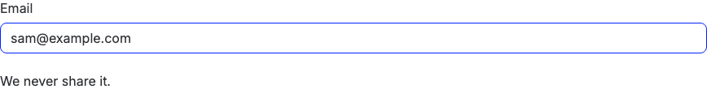 | 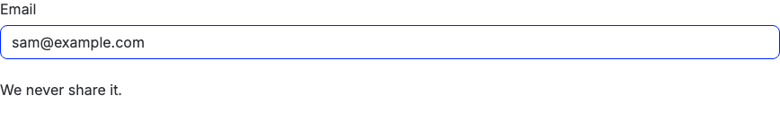 |
| Dark  |   |   |

### Input — error

Error outline #f9b4af → #f04438; error text #f04438 → #d83d32; placeholder #8d9199 → #73767d

|       | Before                                                              | After                                                             |
| ----- | ------------------------------------------------------------------- | ----------------------------------------------------------------- |
| Light | 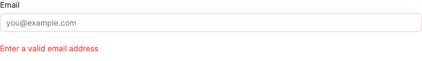 | 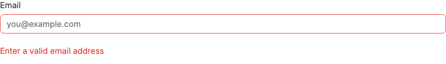 |
| Dark  |   |   |

### TextArea — error

Same as Input; hint text #8d9199 → #73767d

|       | Before                                                                 | After                                                                |
| ----- | ---------------------------------------------------------------------- | -------------------------------------------------------------------- |
| Light | 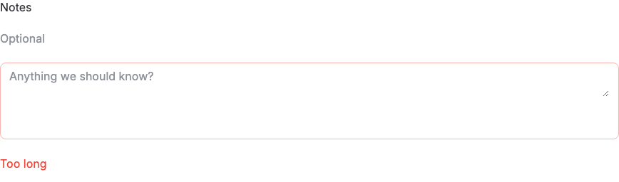 | 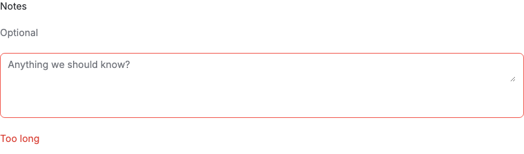 |
| Dark  | 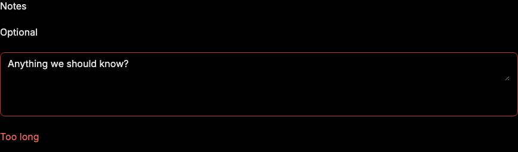  |   |

### SearchBox

Outline #f0f1f2 → #8d9199

|       | Before                                                                        | After                                                                       |
| ----- | ----------------------------------------------------------------------------- | --------------------------------------------------------------------------- |
| Light |  |  |
| Dark  |   |   |

### FieldPicker

Outline #f0f1f2 → #8d9199; placeholder → #73767d

|       | Before                                                                          | After                                                                         |
| ----- | ------------------------------------------------------------------------------- | ----------------------------------------------------------------------------- |
| Light |  |  |
| Dark  |   |   |

### Checkbox — checked

Unchanged when checked (reference)

|       | Before                                                                   | After                                                                  |
| ----- | ------------------------------------------------------------------------ | ---------------------------------------------------------------------- |
| Light |  |  |
| Dark  |   |   |

### Checkbox — error

Outline #f9b4af → #f04438 and doubled in weight (non-colour cue)

|       | Before                                                                 | After                                                                |
| ----- | ---------------------------------------------------------------------- | -------------------------------------------------------------------- |
| Light |  |  |
| Dark  |   |   |

### RadioButton

Unchanged (reference)

|       | Before                                                                    | After                                                                   |
| ----- | ------------------------------------------------------------------------- | ----------------------------------------------------------------------- |
| Light |  |  |
| Dark  |   |   |

### Switch

Track outline #f0f1f2 → #8d9199 (off state)

|       | Before                                                                  | After                                                                 |
| ----- | ----------------------------------------------------------------------- | --------------------------------------------------------------------- |
| Light |  |  |
| Dark  |   |   |

### Badge

Status fills: icon colours → *-strong (#2677ce, #ad6506, #d83d32, #0d884f)

|       | Before                                                                 | After                                                                |
| ----- | ---------------------------------------------------------------------- | -------------------------------------------------------------------- |
| Light |  |  |
| Dark  |   |   |

### Chip

Brand sharp #667aff → #5a6be0; dark: sharp fills darkened

|       | Before                                                              | After                                                             |
| ----- | ------------------------------------------------------------------- | ----------------------------------------------------------------- |
| Light |  | 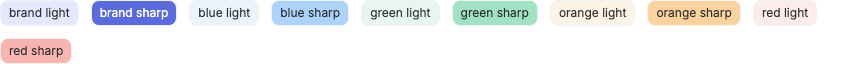 |
| Dark  |   | 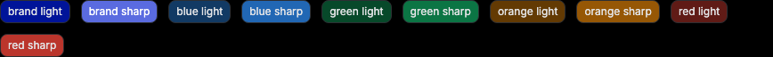  |

### Tag — disabled

Visual unchanged; now aria-disabled

|       | Before                                                               | After                                                              |
| ----- | -------------------------------------------------------------------- | ------------------------------------------------------------------ |
| Light |  |  |
| Dark  |   |   |

### Link

Dark: #334eff → #4b63ff (hover #0022ff → #6b7fff)

|       | Before                                                               | After                                                              |
| ----- | -------------------------------------------------------------------- | ------------------------------------------------------------------ |
| Light |  |  |
| Dark  |   |   |

### DateRangeCalendar

Weekday headers #aaadb3 (disabled) → #73767d

|       | Before                                                                                 | After                                                                                |
| ----- | -------------------------------------------------------------------------------------- | ------------------------------------------------------------------------------------ |
| Light |  |  |
| Dark  |   |   |

### Snackbar — variants

Status titles darkened to ≥4.5:1

|       | Before                                                                  | After                                                                 |
| ----- | ----------------------------------------------------------------------- | --------------------------------------------------------------------- |
| Light | 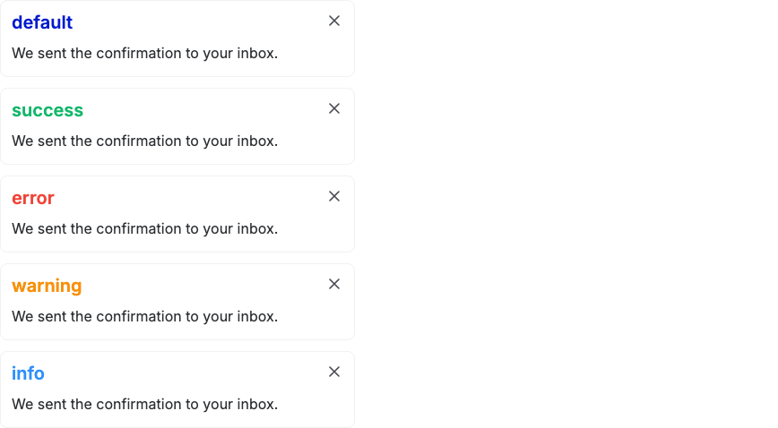 | 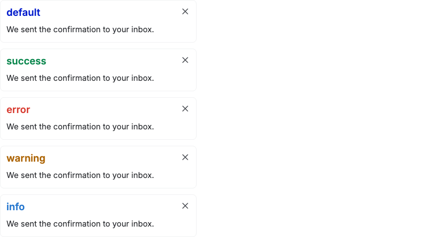 |
| Dark  | 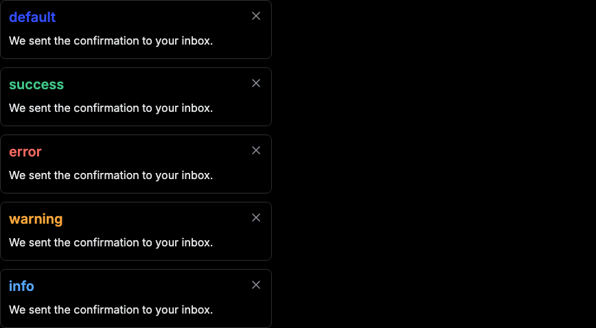  | 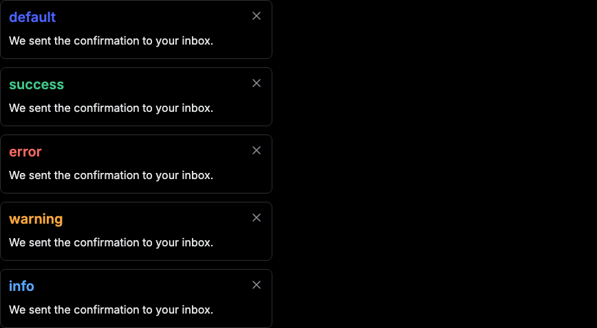  |

### Snackbar — progress

Progress fills darkened to ≥3:1 on their tracks

|       | Before                                                                       | After                                                                      |
| ----- | ---------------------------------------------------------------------------- | -------------------------------------------------------------------------- |
| Light |  |  |
| Dark  |   |   |

### Pagination: target size (WCAG 2.2 SC 2.5.8)

Each dot is now a 24×24px click and tap target. The visible dot is unchanged (8px, or the 20px pill when active), but the dots sit further apart. Was a 12×12px target (8px dot + 2px padding). To go back, restore `width`, `height` and `padding` in `Pagination.module.css` from the comment there. The CSS-only alternative, invisible enlarged hit areas, would overlap neighbouring dots.

|       | Before                                                                     | After                                                                    |
| ----- | -------------------------------------------------------------------------- | ------------------------------------------------------------------------ |
| Light |  |  |
| Dark  |   |   |

In a Card image carousel:

|       | Before                                                                  | After                                                                 |
| ----- | ----------------------------------------------------------------------- | --------------------------------------------------------------------- |
| Light |  |  |
| Dark  |   |   |

## Hover states

The hover fill and hover border went from `#667aff` to `#4b63ff` in both themes: white text on the old fill was 3.63:1, below the 4.5:1 minimum. Found by `pnpm audit:hover`, which hovers every interactive element with the real mouse. The screenshots are taken with the pointer resting on the element named below.

### Button — hover

The Default button is hovered.

|       | Before                                                                         | After                                                                        |
| ----- | ------------------------------------------------------------------------------ | ---------------------------------------------------------------------------- |
| Light |  |  |
| Dark  |   |   |

### Menu item — hover

“Settings” is hovered.

|       | Before                                                                      | After                                                                     |
| ----- | --------------------------------------------------------------------------- | ------------------------------------------------------------------------- |
| Light |  |  |
| Dark  |   |   |

### NavigationPanel item — hover

“Explore” is hovered.

|       | Before                                                                             | After                                                                            |
| ----- | ---------------------------------------------------------------------------------- | -------------------------------------------------------------------------------- |
| Light |  |  |
| Dark  |   |   |

### DialogBox action — hover

“Cancel booking” is hovered.

|       | Before                                                                    | After                                                                   |
| ----- | ------------------------------------------------------------------------- | ----------------------------------------------------------------------- |
| Light | 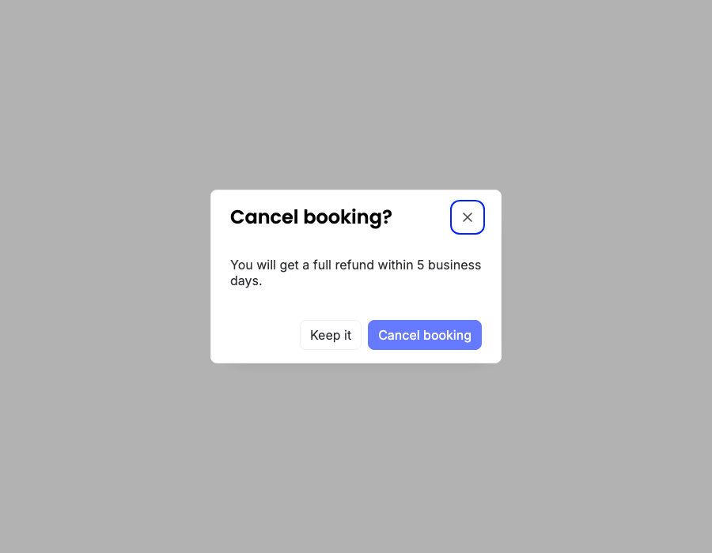 | 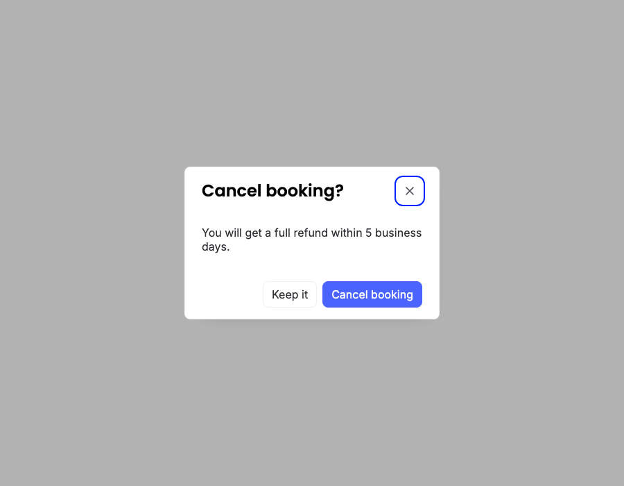 |
| Dark  |   |   |

### SelectButton — hover

The selected button is hovered.

|       | Before                                                                               | After                                                                              |
| ----- | ------------------------------------------------------------------------------------ | ---------------------------------------------------------------------------------- |
| Light |  |  |
| Dark  |   |   |

### RadioButton — hover

The selected option is hovered.

|       | Before                                                                           | After                                                                          |
| ----- | -------------------------------------------------------------------------------- | ------------------------------------------------------------------------------ |
| Light |  |  |
| Dark  |   |   |

### Switch — hover

The switch is hovered.

|       | Before                                                                   | After                                                                  |
| ----- | ------------------------------------------------------------------------ | ---------------------------------------------------------------------- |
| Light |  |  |
| Dark  |   |   |

### Input — hover

The field is hovered (hover border).

|       | Before                                                                       | After                                                                      |
| ----- | ---------------------------------------------------------------------------- | -------------------------------------------------------------------------- |
| Light |  |  |
| Dark  |   |   |

## Polish pass

Fixes from the component review. Screenshots are in `design-changes/polish/` and were taken with `node scripts/design-screenshots.mjs`; the "before" shots come from `main` at `6f6bfdf`. Each story's play function has run, so some shots show the state after the test, such as page 3 of the pagination.

### What changed, and how to go back

| Component         | Now                                                                                               | Was (restore this to go back)                                                                  | Where                                          |
| ----------------- | ------------------------------------------------------------------------------------------------- | ---------------------------------------------------------------------------------------------- | ---------------------------------------------- |
| Icon-only buttons | Square: width = height = standard Button height (lg 38px, sm 30px)                                | Padding only (`xs` lg / `xxs` sm), which made them taller than wide (lg 38 × 41px)             | `Button.module.css`: `.iconOnly`               |
| ProgressCircle    | Percentage inside the ring (small `%`), `label` as a caption beside it; sm ring stroke 5px, r 20  | Any label text centred in the ring at 14px; sm stroke 6px, r 19                                | `ProgressCircle.tsx`, `ProgressBar.module.css` |
| TextArea          | Padding inside the `<textarea>`, which fills the field; `min-height` 106px on the textarea        | Padding and `min-height: 108px` on the field                                                   | `TextArea.module.css`                          |
| Pagination dots   | `surface-indicator` (light `#8d9199`, dark `#5a5e66`); hover `icon-action-hover`, slightly larger | `surface-default` (white on white, black on black); hover `surface-action-hover-light`         | `Pagination.module.css`                        |
| Card image dots   | White in both themes (`tone="onMedia"`)                                                           | `surface-default`: white in light, black in dark                                               | `CardMedia.tsx`                                |
| Table header      | `surface-subtle` (light `#f0f1f2`, dark `#2d2f33`)                                                | `surface-action-hover-light`, the same blue as row hover                                       | `Table.module.css`: `.th`                      |
| Checkbox          | Checked look from the input's `:checked`                                                          | Only from the `checked` prop, so `defaultChecked` and uncontrolled clicks showed no tick (bug) | `Checkbox.module.css`                          |
| Carousel story    | Four slides                                                                                       | One slide, so both arrows were disabled                                                        | `Carousel.stories.tsx`                         |
| Loader            | Two surges per turn, 1.6s (fast, slow, fast, slow)                                                | One constant-speed turn, 0.8s linear                                                           | `Loader.module.css`                            |
| Motion            | `--ds-motion-*` tokens everywhere; durations become 0ms with reduced motion                       | Mixed hard-coded `120ms`/`150ms`/`0.15s ease`, and many states with no transition              | all `*.module.css`, `tokens.json` `motion`     |

### Icon-only buttons

|       | Before                                                                          | After                                                                         |
| ----- | ------------------------------------------------------------------------------- | ----------------------------------------------------------------------------- |
| Light |  |  |
| Dark  |   |   |

### ProgressCircle

The story now has more circles, including "100%" at both sizes.

|       | Before                                                                          | After                                                                         |
| ----- | ------------------------------------------------------------------------------- | ----------------------------------------------------------------------------- |
| Light |  |  |
| Dark  |   |   |

### TextArea

The resize handle is now in the field's corner.

|       | Before                                                                          | After                                                                         |
| ----- | ------------------------------------------------------------------------------- | ----------------------------------------------------------------------------- |
| Light | 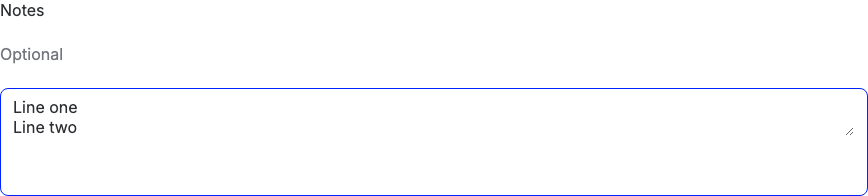 |  |
| Dark  | 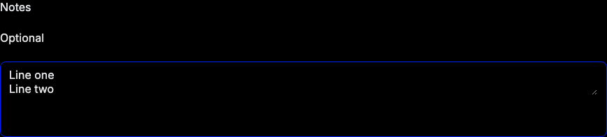  | 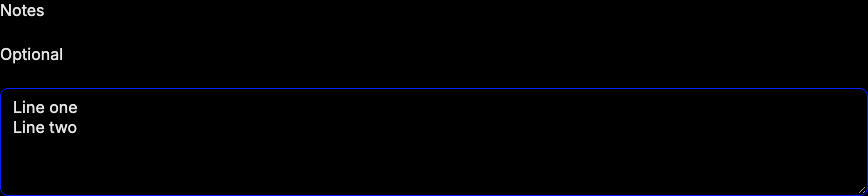  |

### Pagination

|       | Before                                                                            | After                                                                           |
| ----- | --------------------------------------------------------------------------------- | ------------------------------------------------------------------------------- |
| Light |  |  |
| Dark  |   |   |

### Card image dots

|       | Before                                                                         | After                                                                        |
| ----- | ------------------------------------------------------------------------------ | ---------------------------------------------------------------------------- |
| Light |  |  |
| Dark  |   |   |

### Table header

|       | Before                                                                   | After                                                                  |
| ----- | ------------------------------------------------------------------------ | ---------------------------------------------------------------------- |
| Light | 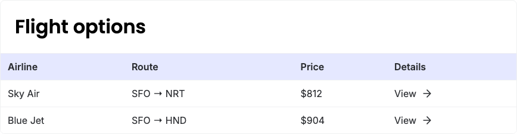 | 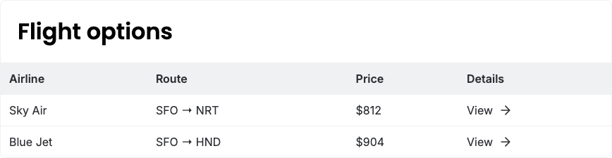 |
| Dark  | 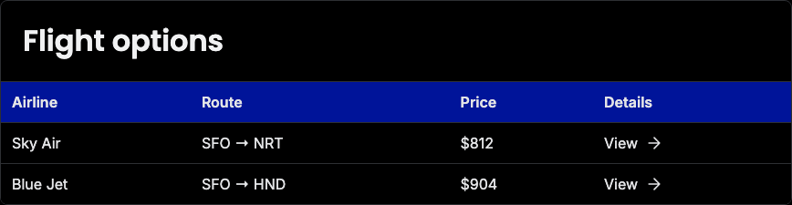  | 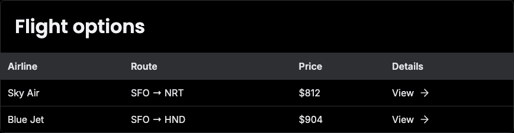  |

### Checkbox — checked (uncontrolled)

|       | Before                                                                          | After                                                                         |
| ----- | ------------------------------------------------------------------------------- | ----------------------------------------------------------------------------- |
| Light |  |  |
| Dark  |   |   |

### Carousel

|       | Before                                                                          | After                                                                         |
| ----- | ------------------------------------------------------------------------------- | ----------------------------------------------------------------------------- |
| Light | 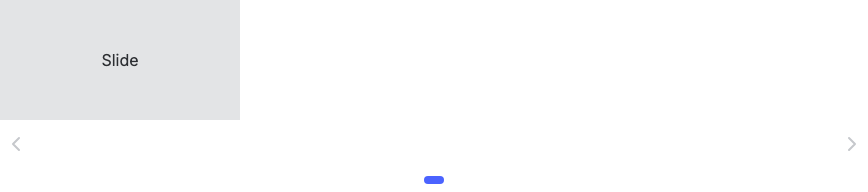 |  |
| Dark  |   |   |
